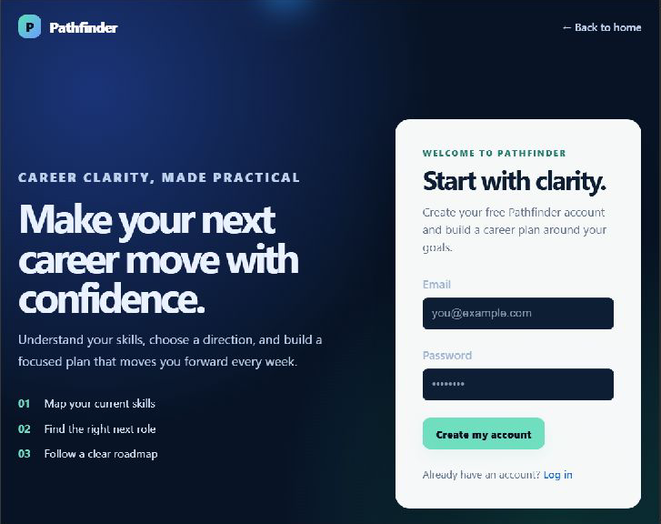

# 🧭 Pathfinder

### Turn a career goal into your next practical step.

Pathfinder is a career-development web app for exploring technology roles, comparing role skills with your current profile, and tracking the learning steps you choose to take.

<p align="center">
  <a href="https://pathfinder-gamma-liard.vercel.app/"><strong>🚀 Open the live app</strong></a>
  &nbsp;·&nbsp;
  <a href="https://github.com/Rippperr/Pathfinder"><strong>💻 View the source</strong></a>
</p>

<p align="center">
  
  
  
</p>

---

## ✨ What you can do

- 🔐 **Create an account** with Supabase Auth, email confirmation, and a guided first-time profile setup.
- 🧭 **Explore technology career paths** with role summaries, responsibilities, skill requirements, and suggested next steps.
- 📊 **See your skill gap** for a selected target role, based on skills in your profile.
- 🪜 **Follow a personalized roadmap** with individual skill steps, learning links, and a completion overview.
- ✅ **Track progress** as To do, In progress, or Completed; add optional project, course, or certificate evidence.
- 👤 **Manage your career profile**, skills, goals, and achievements.
- ⚙️ **Set learning preferences**, update account details, and export your Pathfinder data.
- 📱 **Use a responsive interface** designed for desktop and mobile screens.

## 🖼️ Current app screenshots

These screenshots show the current public-facing design. Dashboard and profile pages require signing in, so no account-specific information is included here.

| ✨ Landing page | 👋 Sign-up page |
| --- | --- |
|  |  |

## 🧰 Built with

| Area | Technology |
| --- | --- |
| Frontend | React 18, React Router 6 |
| Styling | CSS |
| Authentication, database, and storage | Supabase Auth, PostgreSQL, Supabase Storage, Supabase JavaScript client |
| Data security | PostgreSQL Row Level Security (RLS) policies and explicit grants |
| Hosting | Vercel |

> **Recommendation transparency:** Role information and skill-learning guides are curated in the app and supplemented by Supabase role/skill data. Resource ordering uses the user's skill gaps and learning preferences. The current app does **not** call an AI model; recommendations are rule-based rather than AI-generated.

## 🏗️ How it works

1. Sign up or log in through Supabase Auth.
2. Add your current experience, skills, and desired role to your profile.
3. Choose a target role on the dashboard to compare your profile with that role's skill map.
4. Work through roadmap steps, update progress, and optionally add evidence.
5. Pathfinder saves account and profile data in Supabase. Learning preferences sync to the signed-in account, with a local browser fallback if the network is unavailable. Roadmap progress syncs to Supabase when its migration has been applied, with a local browser fallback otherwise.

## 🚀 Run locally

### Requirements

- [Node.js](https://nodejs.org/) (18 or newer recommended)
- npm
- A Supabase project with Pathfinder's required tables and Auth configured

### 1. Clone the repository

```bash
git clone https://github.com/Rippperr/Pathfinder.git
cd Pathfinder/Frontend/client
npm install
```

### 2. Configure Supabase

Create `Frontend/client/.env.local` with your project's URL and **publishable** key (or legacy anon key):

```env
REACT_APP_SUPABASE_URL=https://YOUR_PROJECT_REF.supabase.co
REACT_APP_SUPABASE_PUBLISHABLE_KEY=YOUR_SUPABASE_PUBLISHABLE_KEY
# Alternatively, use the legacy anon key:
# REACT_APP_SUPABASE_ANON_KEY=YOUR_SUPABASE_ANON_KEY
```

Get these values from your Supabase project’s API settings. The frontend must only use a publishable/anon key. **Never put a Supabase secret or service-role key in this file or commit credentials to GitHub.**

> The SQL files in [`supabase/migrations`](supabase/migrations) are incremental migrations for an existing Pathfinder schema; they are not a complete blank-database bootstrap. Configure the base tables and Supabase Auth first. Apply each needed migration once in the Supabase SQL Editor or through your migration workflow.

For roadmap progress, apply [`20261008_add_user_skill_progress.sql`](supabase/migrations/20261008_add_user_skill_progress.sql). It creates a user-scoped table with RLS and grants access to authenticated users.

### 3. Configure Auth redirects

In Supabase **Authentication → URL Configuration**, set the Site URL for your deployment and add the local URL (`http://localhost:3000/`) and live app URL (`https://pathfinder-gamma-liard.vercel.app/`) to the allowed redirect URLs.

### 4. Start the development server

```bash
npm start
```

Open [http://localhost:3000](http://localhost:3000). To create a production build, run:

```bash
npm run build
```

## 🗂️ Project structure

```text
Pathfinder/
├── Frontend/client/       # React application
│   └── src/
│       ├── components/    # Shared layout, auth, and dashboard components
│       ├── contexts/      # Authenticated user and profile context
│       ├── data/          # Built-in role catalog and skill learning guides
│       └── pages/         # Landing, onboarding, dashboard, profile, settings
└── supabase/migrations/   # Incremental PostgreSQL schema and RLS migrations
```

The React app uses Supabase directly for authentication, database access, and avatar storage. There is no separate Express API server in the active architecture. Keep privileged secrets out of the browser; add server-side functions only when a feature needs protected credentials or trusted server-side work.

## 🔒 Supabase security & availability notes

- Keep **Row Level Security enabled** for private user tables and use policies that scope rows to the signed-in user.
- Automatic exposure of newly created tables can be disabled in **Integrations → Data API → Settings**. With it disabled, future tables need explicit grants in their migrations. Grant only the roles and operations the feature requires; Pathfinder's private progress table is for authenticated users, not anonymous access.
- Existing table access is not changed just by disabling automatic exposure. Review exposed tables and their RLS policies periodically.
- Supabase Free projects with low activity over a seven-day period may be paused. A paid Supabase plan avoids inactivity-based pausing; see [Supabase project pausing](https://supabase.com/docs/guides/platform/free-project-pausing) and [plans](https://supabase.com/pricing).
- Add your Supabase environment variables to the Vercel project before deploying. Pushing to `main` is configured to trigger deployment for the live app.

## 🤝 Contributing

Issues and pull requests are welcome. For a feature request, please describe the user problem and the outcome you expect so the change stays focused on practical career development.

## 📄 License

See [LICENSE](LICENSE).
